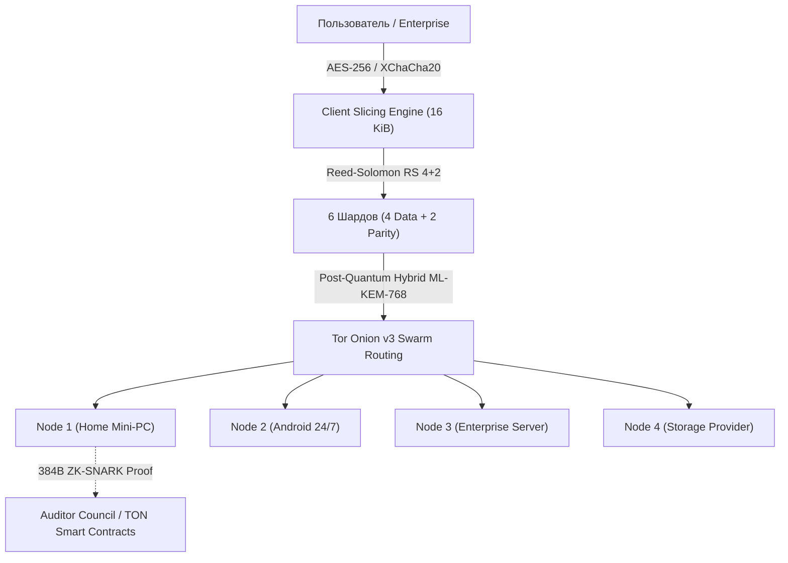
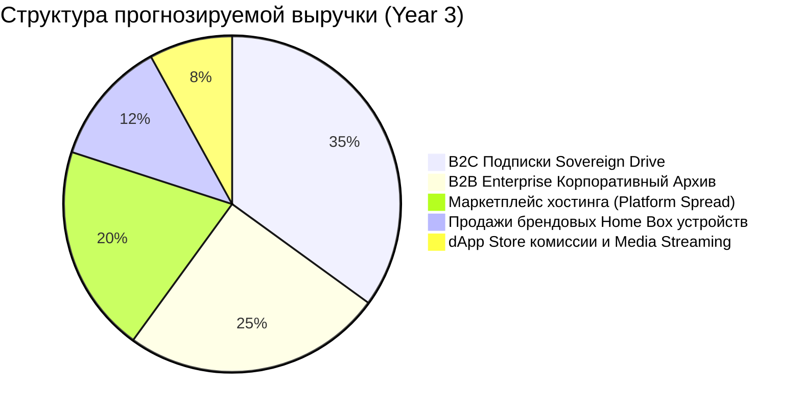
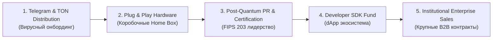

# 🚀 NeXXuS Sovereign Protocol: Инвестиционный меморандум и модель монетизации

> **Конфиденциально.** Презентация для стратегических инвесторов, венчурных фондов (Web3 / Infrastructure / Privacy) и институциональных партнеров.  
> **Версия продукта:** v0.229.0 (100% реализация ядра, готовность к коммерческому запуску).

---

## Executive Summary (Краткое резюме проекта)

**NeXXuS** — это децентрализованный протокол суверенного хранения данных, автономных P2P-вычислений и защищенных коммуникаций, созданный для устранения зависимости от олигополии централизованных облачных провайдеров (AWS, Google Cloud, Microsoft Azure).

### Проблема рынка ($130B+ TAM к 2028 году):
1. **Кризис доверия к Big Tech**: Централизованные облака сканируют пользовательские файлы для обучения ИИ, подвержены цензуре, компрометации данных и блокировкам юрисдикций.
2. **Экспоненциальный рост расходов**: Корпорации и частные пользователи переплачивают за egress-трафик и резервирование дискового пространства до 700% реальной себестоимости железа.
3. **Угроза квантового взлома («Harvest Now, Decrypt Later»)**: Государственные спецслужбы и злоумышленники уже перехватывают зашифрованный трафик с целью его последующей расшифровки на квантовых суперкомпьютерах через 3–5 лет.

### Решение NeXXuS:
- **Zero-Knowledge Storage**: Нарезка на 16 KiB чанки, избыточное кодирование Рида-Соломона **RS(4+2)**, шифрование каждого файла на клиенте **XChaCha20-Poly1305**. Ни один чужой узел не может прочитать данные.
- **Tor Onion v3 Native**: Абсолютная анонимность узлов, отсутствие открытых IP-адресов, обход любых мобильных CGNAT и фаерволов без настройки портов.
- **Post-Quantum Hybrid Shield**: Первый в мире P2P-протокол с гибридным обменом ключами $X25519 \oplus ML\text{-}KEM\text{-}768$ (стандарт NIST FIPS 203 / Kyber). Данные защищены от будущих квантовых компьютеров.
- **Succinct ZK-SNARK PoR**: Мгновенная верификация хранения терабайтов данных через 384-байтные ZK-доказательства без скачивания файлов.

---

## 💎 Технологическое превосходство и защитный ров (Moat)

| Параметр | AWS S3 / Google Drive | Filecoin / Arweave | NeXXuS Sovereign Protocol |
|---|:---:|:---:|:---:|
| **Приватность** | Нулевая (Big Tech сканирует данные) | Публичные транзакции, IP видны | **100% Zero-Knowledge + Tor Onion v3** |
| **Квантовая стойкость** | Отсутствует (классический RSA/ECC) | Отсутствует | **ML-KEM-768 (Kyber) Hybrid Shield** |
| **Запуск ноды** | Недоступно | Дорогое серверное железо, GPU | **Любой ноутбук, Mini-PC или Android-телефон** |
| **Проверка хранения (PoR)** | Доверие корпорации | Медленные тяжелые PoSt (минуты) | **Succinct ZK-SNARK (< 5 миллисекунд)** |
| **Связность за NAT** | Централизованный сервер | Требует белый IP / UPnP | **Tor Onion Rendezvous (100% пробиваемость)** |
| **Готовность ядра** | Legacy проприетарное ПО | Сложные тяжелые клиенты | **100% Safe Rust Core (431 тест GREEN)** |

---

## 💰 6 Потоков монетизации проекта

NeXXuS объединяет традиционную высокомаржинальную SaaS-модель с децентрализованной токеномикой Web3.

### 1. B2C Подписки: Sovereign Personal Cloud (SaaS / Web3)
- **Freemium Barter**: 2 GB защищенного сейфа предоставляются бесплатно при условии предоставления 16 GB свободного дискового пространства взамен (бартер «за пустоту не платим»).
- **Paid Premium Tiers**: Для пользователей, не желающих держать включенный узел или нуждающихся в больших объемах (оплата картой / криптовалютой / TON):
  - **Sovereign Pro (500 GB)**: \$4.99 / месяц.
  - **Sovereign Max (2 TB)**: \$12.99 / месяц.
  - **Family / Creator (10 TB)**: \$49.99 / месяц.
- *Маржинальность*: Себестоимость хранения в распределенном рое составляет ~\$0.80 за 1 TB в месяц. Валовая маржа SaaS-направления превышает **80%**.

### 2. Маркетплейс хостинга и комиссия платформы (Platform Spread)
- Операторы домашних серверов и провайдеры фиксируют контракты хранения через CLI (`nexxusd provider pin --price ...`).
- Протокол берет **10% сервисный сбор (Platform Spread)** с каждой заключенной сделки хранения и ончейн-клиринга.
- При обороте сети в 50 PB выручка со спреда составляет **\$1.8M+ в год**.

### 3. B2B Enterprise & Institutional Cold Archive
- **WORM-хранилище (Write Once, Read Many)** для финансового и медицинского сектора (соответствие требованиям регуляторов SEC, HIPAA, GDPR).
- Корпоративное резервное копирование с гарантией пост-квантовой защиты («квантовый сейф»).
- Средний чек корпоративного B2B-контракта: **\$25,000 – \$150,000 / год**.

### 4. Продажи брендовых аппаратных узлов («NeXXuS Home Box 24/7»)
- Коробочное plug-and-play решение для дома и офиса: энергоэффективный микрокомпьютер (Intel N100 / 16GB RAM / 2TB NVMe) в премиальном металлическом корпусе с предустановленной ОС и нодой NeXXuS.
- Включил в розетку $\rightarrow$ отсканировал QR-код $\rightarrow$ домашний защищенный дата-центр готов.
- *Себестоимость производства*: \$160. *Розничная цена*: \$349.
- *Валовая прибыль с устройства*: **\$189 (54% маржа)**. При продаже 10 000 коробок: **\$1.89M чистой прибыли**.

### 5. dApp Store, Изолированные сервисы и Медиа-стриминг
- Встроенный в ноду рантайм децентрализованных приложений с изоляцией ключей по стандарту **SLIP-0010** ($m/44'/999'/app\_id'/0'$).
- Комиссия 15% с транзакций внутри децентрализованного каталога приложений (против 30% у Apple App Store).
- Монетизация потокового стриминга (Reels, подкасты, аудиокниги) через платные каналы подписки с побайтовой тарификацией (Range Requests).

### 6. Ончейн-клиринг на базе TON и доход от валидации/стейкинга
- Залоговый фонд аудиторов (`auditor_bonds_dict` в смарт-контрактах): минимум 100 TON на узел для участия в проверке доказательств хранения.
- 56-дневный вестинг наград и сжигание долей недобросовестных узлов (Slashing) создают дефляционное давление на токеномику и капитализацию протокола.

---

## 📈 Финансовый прогноз на 3 года (3 сценария развития)

### Основные базовые метрики модели:
- **Целевая аудитория**: Privacy-ориентированные пользователи, крипто-энтузиасты, держатели криптовалют, малый бизнес, разработчики Web3, корпоративные клиенты.
- **Период расчета**: Год 1 (Запуск и выход на рынок), Год 2 (Масштабирование), Год 3 (Глобальная экспансия).

---

### Сценарий 1: Консервативный / Пессимистичный (Pessimistic)
> *Предпосылки*: Медленное органическое признание, развитие преимущественно в среде технических энтузиастов, B2B-сегмент ограничен пилотными проектами.

| Метрика | Год 1 | Год 2 | Год 3 |
|---|:---:|:---:|:---:|
| **Активные ноды в сети** | 3 500 | 12 000 | 35 000 |
| **Объем данных в сети (PB)** | 1.2 PB | 4.5 PB | 15.0 PB |
| **Платящие B2C пользователи** | 2 000 | 8 500 | 25 000 |
| **B2B контракты** | 3 | 12 | 30 |
| **Продажи Home Box (шт.)** | 500 | 2 000 | 5 000 |
| **Годовая выручка (ARR)** | **\$380,000** | **\$1,650,000** | **\$4,820,000** |
| **Чистая прибыль (EBITDA)** | -\$120,000 | \$380,000 | **\$1,850,000** |
| **Оценка проекта (Valuation)** | \$5M | \$15M | **\$40M** |

---

### Сценарий 2: Базовый / Реалистичный (Realistic)
> *Предпосылки*: Успешная экспансия в экосистему TON и Telegram (900 млн пользователей), запуск продаж Home Box, стабильный рост B2B-заказчиков, признание пост-квантового стандарта.

| Метрика | Год 1 | Год 2 | Год 3 |
|---|:---:|:---:|:---:|
| **Активные ноды в сети** | 8 000 | 45 000 | 160 000 |
| **Объем данных в сети (PB)** | 3.5 PB | 22.0 PB | 85.0 PB |
| **Платящие B2C пользователи** | 6 500 | 38 000 | 140 000 |
| **B2B контракты** | 8 | 35 | 110 |
| **Продажи Home Box (шт.)** | 1 500 | 8 000 | 25 000 |
| **Годовая выручка (ARR)** | **\$1,240,000** | **\$6,850,000** | **\$24,600,000** |
| **Чистая прибыль (EBITDA)** | \$210,000 | \$2,450,000 | **\$11,200,000** |
| **Оценка проекта (Valuation)** | \$15M | \$65M | **\$220M** |

---

### Сценарий 3: Прорывной / Оптимистичный (Optimistic)
> *Предпосылки*: Вирусное распространение через Telegram Mini Apps, партнерство с производителями смартфонов и ПК (предустановка на устройства), победа в крупных тендерах суверенного хранения данных для ИИ-кластеров.

| Метрика | Год 1 | Год 2 | Год 3 |
|---|:---:|:---:|:---:|
| **Активные ноды в сети** | 25 000 | 180 000 | 750 000 |
| **Объем данных в сети (PB)** | 10.0 PB | 80.0 PB | 400.0 PB |
| **Платящие B2C пользователи** | 22 000 | 160 000 | 650 000 |
| **B2B контракты** | 20 | 95 | 320 |
| **Продажи Home Box (шт.)** | 5 000 | 30 000 | 100 000 |
| **Годовая выручка (ARR)** | **\$4,150,000** | **\$28,400,000** | **\$108,000,000** |
| **Чистая прибыль (EBITDA)** | \$1,400,000 | \$13,200,000 | **\$58,500,000** |
| **Оценка проекта (Valuation)** | \$50M | \$300M | **\$1.2B+ (Unicorn)** |

---

## 🎯 Стратегический план: «Как добиться оптимизма»

Чтобы проект реализовался по оптимистичному сценарию, сформирована детальная дорожная карта прорыва:

### 1. Экспансия через Telegram Mini App и экосистему TON (Дистрибуция №1)
- Создание официального **NeXXuS Telegram Bot & Mini App**: управление домашним хранилищем прямо из Telegram.
- Интеграция с Telegram Wallet: оплата премиум-тарифов и получение наград хостинга в 1 клик в криптовалюте TON и USDT.
- Доступ к 900 миллионам пользователей Telegram без необходимости преодолевать барьер скачивания сложного софта.

### 2. Запуск доступных коробочных устройств «Home Box»
- Заключение OEM-контрактов с производителями аппаратного обеспечения в Шэньчжэне на сборку брендовых коробок NeXXuS.
- Продажа устройств через Amazon, специализированные маркетплейсы и крипто-сообщества как «бесплатное облако на всю жизнь без абонентской платы».

### 3. Маркетинговое позиционирование: «Первый в мире квантово-стойкий сейф»
- Активная PR-кампания в профильных мировых медиа (CoinDesk, Cointelegraph, TechCrunch, Hacker News) вокруг реализации NIST FIPS 203 ML-KEM-768.
- Проведение открытого аудита криптографии от ведущих мировых аудиторских фирм (Trail of Bits, OpenZeppelin, Kudelski).

### 4. Фонд грантов для разработчиков NeXXuS SDK (\$1.5M)
- Запуск программы грантов для разработчиков децентрализованных приложений: создание мессенджеров, видеохостингов (аналогов YouTube/TikTok на NeXXuS), децентрализованных архивов и блогов.
- Предоставление готовых библиотек на Rust, TypeScript и Kotlin/Android.

### 5. Фокус на Enterprise-комплаенс
- Сертификация протокола по стандартам SOC2 Type II, HIPAA, ISO/IEC 27001.
- Внедрение коробочного коннектора для интеграции с корпоративными резервными системами (Veeam, Bacula, Kubernetes CSI-драйвер).

---

## 💼 Инвестиционное предложение (Round Structure)

- **Цель раунда (Seed / Series A)**: **\$3,000,000**
- **Формат сделки**: SAFE (Simple Agreement for Future Equity) + Token Warrant (дисконт 20% к TGE).
- **Оценка раунда (Cap)**: **\$18,000,000**.

### Распределение привлекаемых средств:
1. **R&D и инженерная команда (40% — \$1.2M)**:
   - Расширение команды Rust/Криптографии.
   - Подготовка мобильных нативных клиентов (Android/iOS).
   - Разработка Kubernetes CSI драйвера.
2. **Маркетинг, дистрибуция и запуск Home Box (30% — \$900k)**:
   - Производство первой промышленной партии Home Box (5 000 единиц).
   - Глобальная кампания продвижения в экосистеме TON/Telegram.
3. **Безопасность и внешний аудит (15% — \$450k)**:
   - Независимый аудит смарт-контрактов TON и пост-квантового ядра.
   - Программа Bug Bounty на Immunefi.
4. **Операционные расходы, юридическое сопровождение и комплаенс (15% — \$450k)**:
   - Создание швейцарского фонда NeXXuS Foundation, патентная защита, юридическая чистота токеномики.

---

## Контактная информация

- **GitHub канонический репозиторий**: [https://github.com/PerfectFriend/NeXXUs-Node](https://github.com/PerfectFriend/NeXXUs-Node)
- **Техническая документация**: [USER_GUIDE.md](file:///home/thomas/Projects/NeXXus-Node/USER_GUIDE.md)
- **План эволюции**: [NEXXUS_100_PERCENT_EVOLUTION_PLAN.md](file:///home/thomas/.gemini/antigravity/brain/494c15d7-b6ef-43b0-836a-aaf8f21c45af/NEXXUS_100_PERCENT_EVOLUTION_PLAN.md)
